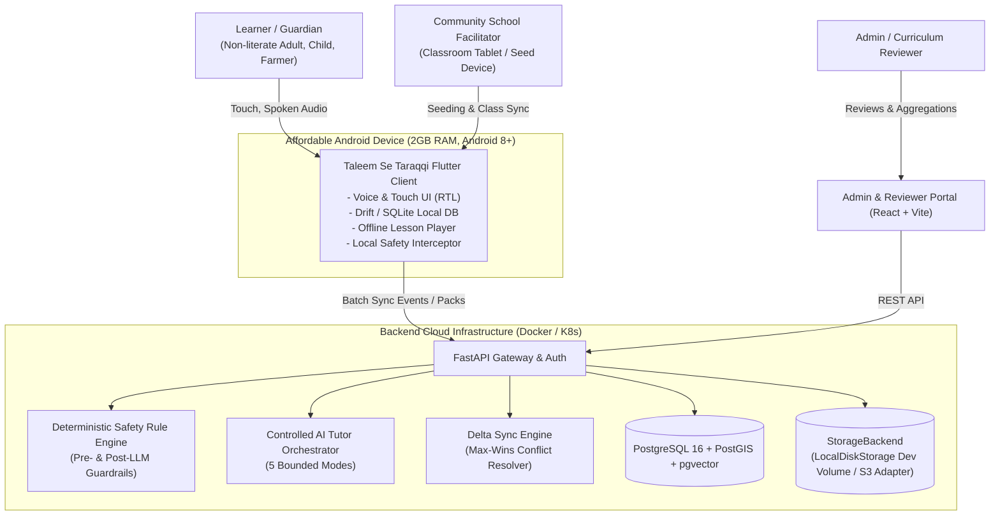
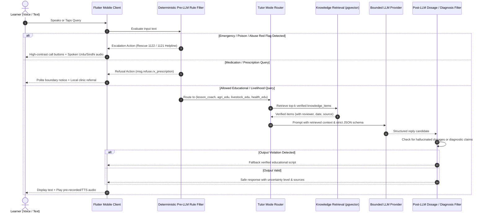
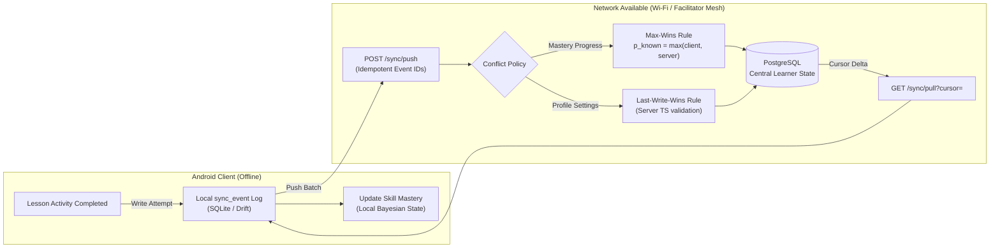

# System Architecture & Technical Design

**Project:** Taleem Se Taraqqi (AI Education for All — Pakistan)  
**Architecture Style:** Offline-First Modular Monolith with Edge Synchronisation & Controlled AI Orchestration

---

## 1. High-Level System Context (C4 Context Diagram)

### Storage Architecture
Asset and content pack distribution is decoupled via `StorageBackend`:
- **Development / Milestone 0–3:** `LocalDiskStorage` backed by a persistent Docker volume (`storage_data:/app/storage`), serving lesson audio, images, and content bundles without external daemon dependencies.
- **Production / Milestone 4+:** `S3Storage` adapter plug-in connecting to remote S3-compatible cloud object storage for regional CDN distribution.

---

## 2. Request & AI Safety Pipeline

Every tutor or guidance query follows this pipeline:

---

## 3. Offline Synchronization Architecture

---

## 4. Threat Model & Security Boundaries

1. **Minors & Safeguarding Threat:** Unauthorized contact with minors.
   - *Mitigation:* Zero open messaging, zero public learner profiles, zero contact list access.
2. **Medical & Agrochemical Liability Threat:** Hallucinated dosage causing human, crop, or livestock harm.
   - *Mitigation:* Hard regex and dictionary pre-LLM and post-LLM rule engine; all knowledge items require human doctor/vet sign-off in `CONTENT_REVIEW.md`.
3. **Stale Information Threat:** Learner dials outdated emergency or hospital number during crisis.
   - *Mitigation:* Listings store `verified_on`. If older than 12 months, app displays and speaks a prominent warning banner.
4. **Data Leakage on Shared Devices:** Sibling or neighbor inspecting another family member's personal progress.
   - *Mitigation:* 4-symbol picture PIN per profile; session locks on profile switch; AES-256 database encryption via SQLCipher.
